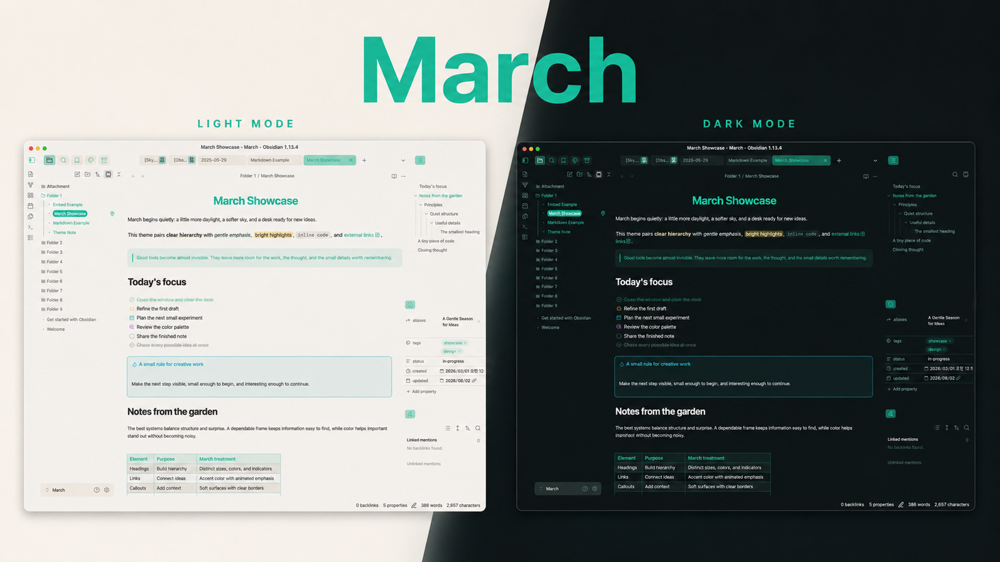
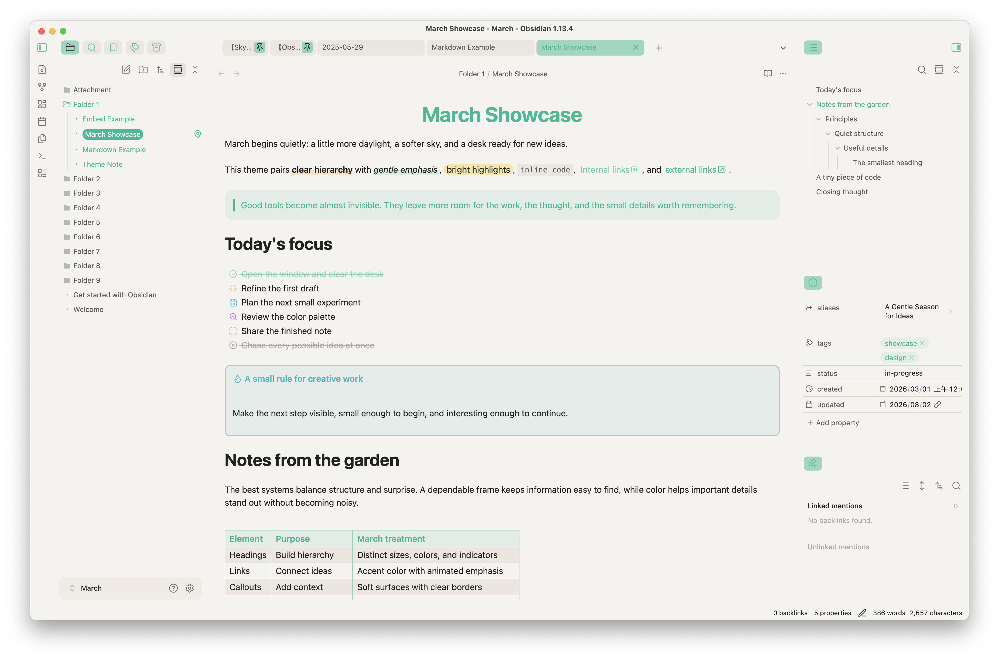
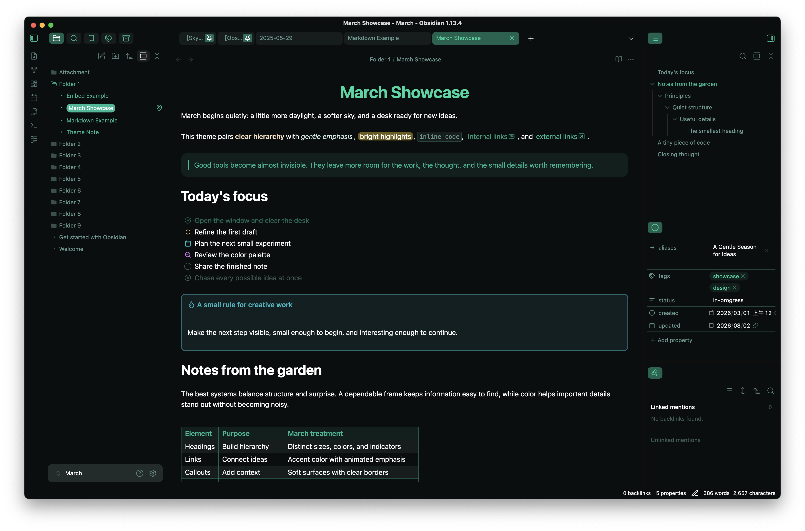

# March



March is a colorful, accent-aware theme for [Obsidian](https://obsidian.md/) with soft surfaces, playful typography, and a focused writing experience. It supports both light and dark mode and stays close to Obsidian's native behavior while giving notes and the surrounding interface a distinct visual rhythm.

## Features

- Warm light and accent-tinted dark appearances
  - 
  - 
- Optional Catppuccin and Nord color schemes
- Color-coded headings with configurable size, alignment, color, and indicators
- Refined links, highlights, bold and italic text, blockquotes, callouts, embeds, tables, and horizontal rules
- Code blocks with line numbers and configurable colors
- Alternate task states for done, canceled, in progress, planned, and review
- An optional colorful frame layout, compact pinned tabs, and file-type icons
- Styling for Obsidian Bases and small compatibility refinements for selected community plugins
- Extensive customization through the Style Settings plugin

## Installation

### Community Themes

Once March is available in the Obsidian Community Themes gallery:

1. Open **Settings → Appearance**.
2. Next to **Themes**, select **Manage**.
3. Search for **March**.
4. Select **Install and use**.

### BRAT

You can install the latest version directly from GitHub with [BRAT](https://github.com/TfTHacker/obsidian42-brat):

1. Install and enable **BRAT** from **Settings → Community plugins**.
2. Open **Settings → BRAT → Beta Themes List**.
3. Select **Add Beta Theme**.
4. Enter `https://github.com/sakurastral/obsidian-march-theme`.
5. Select **Add Theme**, then enable March from **Settings → Appearance**.

BRAT follows the repository's latest theme files, so beta builds may change more frequently than Community Themes releases.

### Manual installation

1. Download `manifest.json` and `theme.css` from the [latest release](https://github.com/sakurastral/obsidian-march-theme/releases/latest).
2. Create `<vault>/.obsidian/themes/March/`.
3. Place both files in that folder.
4. Reload Obsidian and select **March** in **Settings → Appearance**.

## Style Settings

March works without additional plugins, but the [Style Settings](https://github.com/mgmeyers/obsidian-style-settings) community plugin unlocks its customization controls.

1. Install and enable **Style Settings** from **Settings → Community plugins**.
2. Open **Settings → Style Settings**.
3. Expand one of the March sections.

| Section                    | Available controls                                                                               |
| -------------------------- | ------------------------------------------------------------------------------------------------ |
| March Theme - Color Scheme | Default, Catppuccin, and Nord schemes; palette, surface, text, and formatted-text colors         |
| March Theme - Editor       | Headings, links, checkboxes, code blocks, blockquotes, callouts, embeds, and horizontal rules    |
| March Theme - Layout       | Frame style, title bar and tab colors, scrollbar width, spacing, pinned tabs, and font ligatures |

## Alternate checkboxes

March includes visual states for the following task markers:

| Markdown | State       |
| -------- | ----------- |
| `- [ ]`  | To do       |
| `- [/]`  | In progress |
| `- [p]`  | Planned     |
| `- [r]`  | Review      |
| `- [x]`  | Done        |
| `- [-]`  | Canceled    |

The planned and review icons can be enabled or disabled in Style Settings.

## Image helpers

Add a fragment to an Obsidian image embed to apply these built-in helpers:

| Effect                    | Markdown                |
| ------------------------- | ----------------------- |
| Center an image           | `![[image.png#center]]` |
| Crop an image to a circle | `![[image.png#circle]]` |

## Integrations

March includes targeted styles or css helper classes for:

- [Style Settings](https://github.com/mgmeyers/obsidian-style-settings)
- [Pretty Properties](https://github.com/anareaty/pretty-properties)
- [Note Toolbar](https://github.com/chrisgurney/obsidian-note-toolbar)
- Obsidian Bases

These integrations are optional and are not bundled with the theme.

## Development

```bash
npm ci
npm run build
```

Use `npm run watch` while editing files in `src/` to rebuild `theme.css` automatically.

## Feedback

If you find a styling issue or have a suggestion, please [open an issue](https://github.com/sakurastral/obsidian-march-theme/issues). When reporting a problem, include your Obsidian version, operating system, enabled CSS snippets, and steps to reproduce it.

## Credits

March includes ideas or adapted techniques from the following projects and communities:

- [Minimal](https://github.com/kepano/obsidian-minimal)
- [AnuPpuccin](https://github.com/AnubisNekhet/AnuPpuccin)
- [Border](https://github.com/Akifyss/obsidian-border)
- [Primary](https://github.com/primary-theme/obsidian)
- [Cupertino](https://github.com/aaaaalexis/obsidian-cupertino)
- [Maple](https://github.com/subframe7536/obsidian-theme-maple)
- [Catppuccin](https://catppuccin.com/) and [Nord](https://www.nordtheme.com/) color palettes
- [Lucide](https://lucide.dev/) icons
- The [Obsidian Forum](https://forum.obsidian.md/) and Obsidian Discord community

See the comments in `src/` for more specific source references.

## License

March is released under the [MIT License](LICENSE).
